  

  
  
  
  
  
  
  
  

---

# 🤖 Awesome AI Executive Assistant 🚀

A comprehensive, curated collection of top-tier **AI Executive Assistants**, **autonomous scheduling agents**, **intelligent calendar managers**, and **inbox triage platforms**. Whether you are looking for enterprise-grade proprietary SaaS solutions with verified pricing and valuations or self-hosted open-source AI agent workflows, this directory equips founders, executives, engineers, and product teams to automate routine administrative friction and protect high-leverage focus time.

---

## 📑 Table of Contents
- [🌐 Sector Overview & Market Dynamics](#-sector-overview--market-dynamics)
- [💼 Commercial SaaS AI Executive Assistants](#-commercial-saas-ai-executive-assistants)
- [🔓 Open-Source AI Assistants & Scheduling Repositories](#-open-source-ai-assistants--scheduling-repositories)
- [🎯 Key Selection Criteria & Evaluation](#-key-selection-criteria--evaluation)
- [🤝 Contributing](#-contributing)
- [⭐ Star History](#-star-history)
- [💖 Support](#-support)
- [📜 License](#-license)

---

## 🌐 Sector Overview & Market Dynamics

The global AI executive assistant and scheduling market is projected to reach between **$5.0B and $7.1B by 2026**, expanding at a rapid **CAGR exceeding 32%** as knowledge workers and modern leadership teams shift away from static booking links toward dynamic, agentic workflow orchestration. The sector is **highly fragmented**, characterized by a continuous tug-of-war between big-tech ecosystem giants (Microsoft Copilot, Google Workspace) bundling basic calendar utilities and hyper-specialized SaaS disruptors deploying multi-agent reasoning, deep calendar constraint solvers, and autonomous human-in-the-loop executive coordination.

---

## 💼 Commercial SaaS AI Executive Assistants

A benchmarked directory of commercial SaaS products designed for executive scheduling, automated calendar planning, task time-blocking, and executive communications. 

> Sorted descending by **Company Scale (Valuation / Revenue / Exit Valuation)**:

| Product | Company Scale (Valuation / Revenue) | Starting Price (Specific Tier) | Free Tier / Free Trial Limits | Key Highlights & Capabilities |
| :--- | :--- | :--- | :--- | :--- |
| **[Motion](https://usemotion.com)** ⚡ | **$550M Valuation** (Mid-8-figures ARR, $102M raised) | **$19/seat/mo** (billed annually) or $29/mo (solo annual) | **7-day free trial** with complete access to Pro AI scheduling features (requires valid payment method upon signup) | Autonomous task prioritization, calendar time-blocking, meeting booking, and multi-agent "AI Employees". |
| **[Reclaim.ai](https://reclaim.ai)** 🛡️ | **Acquired by Dropbox (~$2.1M ARR at exit)** | **$10/seat/mo** (Starter tier billed annually, or $12/mo monthly) | **Free Forever "Lite" Plan**: 1 user, up to 5 AI agents/habits, 1 calendar sync, and 1-week scheduling horizon | Adaptive time defense for habits, 1:1 meeting auto-scheduling, task integration (Linear/Jira/Asana), and buffer protection. |
| **[Lindy.ai](https://lindy.ai)** 🧠 | **$50M+ Raised** (~$5.1M estimated ARR) | **$29.99/user/mo** (Plus tier with monthly pooled credit allocation) | **7-day free trial** on paid tiers with full agent capabilities; free exploration tier with introductory starter credits | Modular executive assistant agents for multi-inbox triage, automatic CRM logging, meeting notes, and web workflow orchestration. |
| **[Clara Labs](https://claralabs.com)** ✉️ | **$11.8M Raised** (Acquired / Backed by Sequoia & YC) | **$99/user/mo** (Essential plan with `@claralabs.com` assistant email) | **14-day free trial** with full automated natural language email scheduling and calendar negotiation (no credit card required) | Human-in-the-loop email assistant acting as a real-sounding executive assistant (`clara@...`) managing back-and-forth invitations. |
| **[Vimcal](https://vimcal.com)** 🏎️ | **$8.9M Raised** (~$2.0M estimated ARR) | **$20/user/mo** (billed annually) or $25/mo monthly | **Free Forever iOS Mobile App** for core calendar scheduling; desktop version offers demo and onboarding preview | Built for speed ("Superhuman for Calendar"), keyboard-first workflows, instant time-slot sharing, and AI Free-Time finder. |
| **[Sabi](https://meetsabi.com)** 📱 | **Early Stage / Bootstrapped** (Private revenue) | **$295/month** (Flat-rate Sabi Pro month-to-month plan) | **Starter Credit Allowance**: Complimentary test runs on personal inbox and tasks without upfront credit card commitment | Conversational SMS/WhatsApp/text-first executive assistant handling calendar management, reservations, and admin tasks. |

---

## 🔓 Open-Source AI Assistants & Scheduling Repositories

Explore autonomous, self-hostable, and hackable open-source frameworks, agentic workflows, and scheduling primitives.

> Sorted descending by **GitHub Stargazers count** (badges link directly to stargazers):

1. **[LobeHub](https://github.com/lobehub/lobehub)**  🌟
   - *Description:* Autonomous Chief Agent Operator platform that organizes, hires, schedules, and reports on 24/7 AI teams across multiple roles.
   - *Tech Stack:* TypeScript, Next.js, OpenAI/Anthropic APIs, Docker.

2. **[Cal.com](https://github.com/calcom/cal.com)**  📅
   - *Description:* Open-source scheduling infrastructure for everyone with native AI booking primitives, cal-ai agents, and enterprise routing.
   - *Tech Stack:* TypeScript, Next.js, Prisma, Tailwind CSS, tRPC.

3. **[Khoj](https://github.com/khoj-ai/khoj)**  🧠
   - *Description:* An open-source, self-hostable AI second brain and personal assistant that automates research, schedules tasks, and organizes documents.
   - *Tech Stack:* Python, FastAPI, PyTorch, React, Local LLMs (Llama, Mistral, Qwen).

4. **[SenteLabsAI / OpenExecutive](https://github.com/SenteLabsAI/OpenExecutive)**  👔
   - *Description:* An AI-powered virtual executive team featuring a single unified executive persona supported by 8 specialized multi-agent domain experts.
   - *Tech Stack:* Python, FastAPI, Next.js, Multi-Agent Architecture.

5. **[LangChain Executive AI Assistant (EAIA)](https://github.com/langchain-ai/executive-ai-assistant)**  🤖
   - *Description:* Production-ready LangGraph reference architecture implementing autonomous email triage, calendar gatekeeping, and meeting briefings.
   - *Tech Stack:* Python, LangGraph, LangChain, Gmail API, Google Calendar API.

6. **[mgonto / executive-assistant-skills](https://github.com/mgonto/executive-assistant-skills)**  🛠️
   - *Description:* Curated OpenClaw executive skill collection designed to automate executive assistant duties, meeting prep, and executive digests.
   - *Tech Stack:* Python, OpenClaw Agent Skills, LLM Tool Calling.

7. **[AutoPhd-org / schedule-everything](https://github.com/AutoPhd-org/schedule-everything)**  ⏱️
   - *Description:* Lightweight local engine for programmatic scheduling and automated task queue execution on your personal workstation.
   - *Tech Stack:* Python, AsyncIO, Local Process Scheduling.

---

## 🎯 Key Selection Criteria & Evaluation

When choosing between proprietary SaaS and self-hosted open-source AI executive assistants, assess the following trade-offs:

- 🔒 **Data Privacy & Compliance:** High-profile executive communications, contracts, and calendars demand strict SOC-2 Type II, GDPR, and enterprise data retention policies.
- ⚡ **Autonomous Execution vs. Human Oversight:** Look for tools offering configurable supervisory thresholds ("human-in-the-loop") for sensitive external emails or board-level appointments.
- 🔄 **Ecosystem Interoperability:** Ensure bidirectional synchronisation with Google Workspace, Microsoft 365, Slack, and project trackers (Linear, Jira, Notion).
- 💰 **Total Cost of Ownership (TCO):** Weigh monthly per-seat SaaS costs against the infrastructure and API token burn required for self-hosted multi-agent frameworks.

---

## 🤝 Contributing

Contributions are warmly welcomed! Please read the guidelines below before submitting a Pull Request:

1. 🍴 Fork the repository.
2. 🌿 Create your feature branch (`git checkout -b feature/add-new-assistant`).
3. 📝 Follow existing formatting:
   - For SaaS additions: include exact tier pricing, precise free tier/trial limits, company scale, and link to official domains.
   - For Open-Source additions: include the repository link, Stars_Count badge (`style=social&color=white`), tech stack, and summary.
4. 🚀 Commit your changes (`git commit -m "feat: add [Tool Name]"`).
5. 📬 Push to the branch and open a Pull Request!

---

## ⭐ Star History

---

## 💖 Support

Thank you for exploring **Awesome AI Executive Assistant**! If you find this curated collection valuable or inspiring, please consider supporting the project:

- ⭐ **Star this repository** on GitHub to help others discover it.
- 🍴 **Fork and share** it with colleagues, founders, and your developer network.
- ☕ **Buy me a coffee**: If you'd like to support ongoing curation and maintenance, visit my [Sponsor Dashboard](https://github.com/sponsors/ishandutta2007) — every bit of encouragement fuels further open-source research and community guides!

---

## 📜 License

This project is open-source under the [MIT License](LICENSE).
